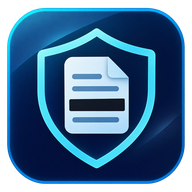

<p align="center">
  
</p>

<h1 align="center">PDF Forensic Sanitizer</h1>

<p align="center"><strong>Oscuramento PDF e ricostruzione raster nel rispetto della privacy.</strong><br>I tuoi documenti. Il tuo dispositivo. Il tuo controllo.</p>

<p align="center"><a href="README.md">English</a> | <strong>Italiano</strong></p>

<p align="center">
  <a href="https://0xnull-profile.github.io/pdf-forensic-sanitizer/">Apri la versione Web</a> |
  <a href="https://github.com/0xnull-profile/pdf-forensic-sanitizer/releases/download/v1.0.0-rc.1/PDF-Forensic-Sanitizer-1.0.0-rc.1-Windows-x64.exe">Scarica Windows Portable</a> |
  <a href="https://github.com/0xnull-profile/pdf-forensic-sanitizer/releases/tag/v1.0.0-rc.1">Release e checksum</a>
</p>

> **Stato della release:** `v1.0.0-rc.1` è una **versione preliminare pubblica**, non ancora la stabile `v1.0.0`. L'applicazione non possiede una certificazione indipendente di sicurezza.

## Perché nasce il progetto

Per oscurare informazioni riservate in un PDF non dovrebbe essere necessario caricare il documento su un servizio online. **PDF Forensic Sanitizer** è uno strumento *local-first* di **0xnull-profile**: permette di esaminare PDF, oscurare aree sensibili ed esportare un nuovo PDF composto da immagini.

Il documento selezionato viene elaborato sul dispositivo dell'utente. L'applicazione **non** dispone di un endpoint per caricare PDF, di un servizio cloud di conversione o di telemetria applicativa. La versione Web scarica comunque i propri asset da GitHub Pages: il primo caricamento e gli aggiornamenti dipendono da una rete e da un browser affidabili.

## Scegli la versione

| | Versione Web | Windows Portable |
| --- | --- | --- |
| Accesso | [Apri nel browser](https://0xnull-profile.github.io/pdf-forensic-sanitizer/) | [Scarica `.exe` (x64)](https://github.com/0xnull-profile/pdf-forensic-sanitizer/releases/download/v1.0.0-rc.1/PDF-Forensic-Sanitizer-1.0.0-rc.1-Windows-x64.exe) |
| Installazione | Nessuna installazione dell'app | Nessun Node.js, Python o server HTTP manuale |
| Uso offline | Dopo la memorizzazione completa degli asset statici e la conferma di disponibilità | Risorse incorporate; funziona senza connessione Internet |
| Interfaccia | Web/PWA responsive, comandi touch | Finestra desktop autonoma per Windows |
| Uso consigliato | Accesso rapido e smartphone | Elaborazione di documenti con rete disconnessa |

**Utenti Windows:** scarica il file portabile dalla release ufficiale, verificane l'integrità se possibile e aprilo. Non servono strumenti di sviluppo o installazioni manuali. L'eseguibile attuale è **privo di firma digitale**: Windows potrebbe mostrare un avviso sull'editore. Non disattivare le protezioni di sicurezza del sistema per eseguirlo.

## Funzionalità

- Esamina PDF multipagina e segnala testo, metadati ed elementi interattivi rilevabili.
- Permette di creare maschere di oscuramento nere, spostarle, ridimensionarle o eliminarle prima dell'esportazione.
- Converte **ogni** pagina in pixel, applica le maschere e ricostruisce un **nuovo PDF composto da immagini**, evitando semplici rettangoli sovrapposti al testo originale.
- Supporta filigrana opzionale e regolazione della risoluzione di esportazione.
- Riapre e verifica il PDF generato prima di consentirne il salvataggio.
- Utilizza PDF.js e pdf-lib locali, senza dipendenze da CDN durante l'esecuzione.
- Offre l'interfaccia responsive **Forensic Glass**, controlli touch e cache offline della sola applicazione Web.

La ricostruzione raster elimina intenzionalmente la selezione e la ricerca del testo nell'output. **Non garantisce che ogni informazione sensibile sia stata coperta correttamente:** contenuti rimasti visibili possono essere letti oppure recuperati tramite OCR.

## Guida rapida

### Versione Web

1. Apri la [Web Edition](https://0xnull-profile.github.io/pdf-forensic-sanitizer/).
2. Seleziona un PDF dal dispositivo ed esamina i risultati dell'analisi delle pagine.
3. Disegna e regola le maschere sulle informazioni da oscurare.
4. Controlla tutte le pagine, conferma l'esportazione e salva il PDF raster verificato.
5. Per lavorare offline, attendi che l'app confermi la disponibilità della cache statica **prima** di disconnetterti. Il funzionamento offline dipende anche dal mantenimento di tale cache da parte del browser.

### Windows Portable

1. Scarica il [file `.exe` per Windows x64](https://github.com/0xnull-profile/pdf-forensic-sanitizer/releases/download/v1.0.0-rc.1/PDF-Forensic-Sanitizer-1.0.0-rc.1-Windows-x64.exe).
2. Spostalo nella cartella che preferisci. Non richiede installazione né server locali.
3. Per i documenti più riservati, disconnetti la rete prima di aprire il file.
4. Avvia il programma, importa il PDF, applica le maschere ed esporta nella destinazione scelta.

**Suggerimento:** conserva una copia separata dell'originale e controlla visivamente tutte le pagine esportate prima di condividerle.

## Privacy, sicurezza e limiti

Il modello di sicurezza privilegia **elaborazione locale**, **ricostruzione raster** e **integrità verificabile delle distribuzioni**, ma nessun sanitizzatore PDF può garantire riservatezza assoluta.

- **Nessun backend di elaborazione:** l'app è progettata per non trasmettere i PDF selezionati a un server. La versione desktop può essere utilizzata senza rete.
- **Nessuna cache dei documenti:** la allowlist del Service Worker Web comprende le risorse statiche dell'app, non i PDF importati. La persistenza gestita dal browser, dal sistema operativo e dai file scaricati non è completamente controllabile dall'app.
- **Limiti degli header GitHub Pages:** la versione Web **non** soddisfa il profilo completo di hardening degli header HTTP previsto dal progetto. Una CSP in un meta tag non può applicare `frame-ancestors` e l'hosting non fornisce la CSP necessaria nelle risposte dei worker. L'offline attenua alcuni rischi, ma non equivale a queste protezioni.
- **Limiti della sanitizzazione:** la pipeline raster sostituisce le strutture del PDF originale negli scenari testati; rimangono possibili difetti di rendering, errori nel posizionamento delle maschere, testo visibile e riconoscimento OCR. Il PDF finale perde la ricerca e la selezione del testo.
- **Rischi del dispositivo:** estensioni malevole, sistema operativo compromesso e altre applicazioni locali non vengono neutralizzati dallo strumento.
- **Nessuna certificazione:** i test automatici e le analisi indipendenti con MuPDF su file sintetici non costituiscono un audit esterno né una garanzia per qualsiasi PDF.
- **Eseguibile Windows non firmato:** la build portabile non dispone attualmente di firma Authenticode.

Per documenti molto sensibili, preferisci Windows Portable con la rete disconnessa, usa un dispositivo affidabile e controlla manualmente il risultato. Non usare questo software come unica garanzia quando è richiesta una validazione formale di sicurezza o conformità.

## Verifica dei download

La release Windows contiene l'eseguibile portabile e `WINDOWS-SHA256SUMS.txt`. Scarica **entrambi** dalla [release ufficiale](https://github.com/0xnull-profile/pdf-forensic-sanitizer/releases/tag/v1.0.0-rc.1).

Da Git Bash o da un ambiente con `sha256sum`, nella cartella dei download:

```sh
sha256sum -c WINDOWS-SHA256SUMS.txt
```

In PowerShell puoi anche calcolare l'hash e confrontarlo manualmente con quello del file di checksum:

```powershell
Get-FileHash -Algorithm SHA256 ".\PDF-Forensic-Sanitizer-1.0.0-rc.1-Windows-x64.exe"
```

La distribuzione Web comprende i [checksum SHA-256](RELEASE-SHA256SUMS.txt) e la [distinta software SPDX](SBOM.spdx.json). **Un checksum ospitato insieme al file consente di rilevare modifiche, ma da solo non autentica il produttore in modo indipendente.** I README sono documentazione del repository, non file della `dist/` inclusi nel relativo manifest di checksum.

## Trasparenza del progetto

Il repository pubblico contiene la **distribuzione Web** pronta all'uso e gli allegati delle release Windows. Il repository di sviluppo separato, con sorgenti completi, strumenti di compilazione e test, è **privato in questa fase**. Pertanto non si deve presentare questo repository come un rilascio completo dei sorgenti open source. Per i diritti di utilizzo fanno fede solo gli eventuali termini di licenza pubblicati esplicitamente: la disponibilità pubblica dei file non implica automaticamente una licenza open source.

L'interfaccia utente è attualmente in **italiano**. Il README è disponibile in [inglese](README.md) e in [italiano](README.it.md).

Hai trovato un bug? Se abilitata, utilizza la sezione [GitHub Issues](https://github.com/0xnull-profile/pdf-forensic-sanitizer/issues) con un esempio **sintetico o anonimizzato**. Non caricare mai PDF riservati, credenziali o dati personali in una segnalazione pubblica. Per una vulnerabilità sensibile utilizza un contatto privato, anziché pubblicare i dettagli dell'attacco.

---

<p align="center"><strong>0xnull-profile</strong> | Strumenti privacy-first, con il controllo nelle mani dell'utente.</p>
